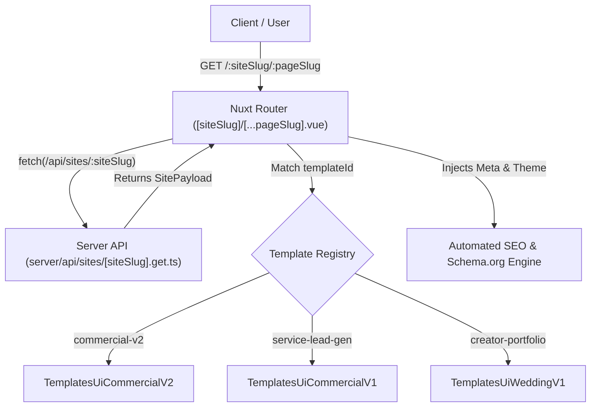

<p align="center">
  <a href="https://github.com/Modest-Human-Brands/mwap">
    <picture>
      <source media="(prefers-color-scheme: dark)" srcset="https://raw.githubusercontent.com/Modest-Human-Brands/mwap/main/public/logo.png">
      <source media="(prefers-color-scheme: light)" srcset="https://raw.githubusercontent.com/Modest-Human-Brands/mwap/main/public/logo.png">
      
    </picture>
  </a>
</p>

<h1 align="center">MWap</h1>

<p align="center">
  <strong>Template-Driven Website & App Builder with Automated SEO, powered by Nuxt 4, Tauri v2, Tailwind CSS, and Bun.</strong>
</p>

<p align="center">
  <a href="https://github.com/Modest-Human-Brands/mwap/blob/main/LICENSE"></a>
  <a href="https://nuxt.com"></a>
  <a href="https://v2.tauri.app"></a>
  <a href="https://bun.sh"></a>
  <a href="https://tailwindcss.com"></a>
  <a href="https://www.typescriptlang.org"></a>
  <a href="https://github.com/Modest-Human-Brands/mwap/actions"></a>
</p>

---

## Overview

**MWap** is a production-grade, **template-driven Website and Application Builder** engineered with **Nuxt 4**, **Tauri v2**, **Tailwind CSS**, and **Bun**. It acts as an automated site generator and multi-target compilation engine, ingesting structured CMS or API payloads to build and render customized, high-converting websites and native applications on demand.

Equipped with an **automated enterprise SEO pipeline**, MWap automatically injects structured `Schema.org` data, dynamic OpenGraph/Twitter social cards, brand typography, custom favicon stylesheets, CSS root brand variables, and dynamic XML sitemaps per tenant. The unified codebase compiles to Server-Side Rendered (SSR) web apps, installable Progressive Web Apps (PWA), and native cross-platform desktop (macOS, Windows, Linux) and mobile (Android) binaries.

### Features

- 🏗️ **Template-Driven Site & App Builder**: Ingests JSON/CMS payloads (`SitePayload`) and dynamically resolves templates (`commercial-v2`, `service-lead-gen`, `creator-portfolio`) across multi-page layouts via dynamic router `app/pages/[siteSlug]/[...pageSlug].vue`.
- 🔍 **Automated End-to-End SEO Pipeline**: Powered by `@nuxtjs/seo`, automated XML sitemaps with `autoLastmod`, robots index rules, runtime `Schema.org` (`WebSite`, `WebPage`), OpenGraph / Twitter meta generation, and canonical link handling.
- 🎨 **Dynamic Brand & Theme Rehydration**: Injects tenant brand colors into CSS variables (`--brand-primary`, `--brand-secondary`, `--brand-accent`, `--brand-bg`, `--brand-text`), loads external Google Fonts dynamically, and updates favicons per site.
- 📱 **Universal Cross-Platform Compilation**: Deploy once to Web (Nitro SSR or static SSG), Native Desktop (macOS Apple Silicon & Intel, Windows, Linux), and Native Mobile (Android APK/AAB) using Tauri v2.
- 🔄 **Native In-App Auto-Updater**: Turnkey desktop update pipeline powered by `@tauri-apps/plugin-updater` with Ed25519 signing and a turnkey `useAppUpdater` Vue composable.
- 🤖 **Model Context Protocol (MCP) Server**: Server-side AI agent integration via `@nuxtjs/mcp-toolkit`, exposing type-safe Zod tools (`server/mcp/tools/`) directly to AI assistants.

---

## Visual Demo

<p align="center">
  
</p>

---

## Quick Start

### Prerequisites

- **Package Manager**: [Bun](https://bun.sh) `^1.2.9` (lockfile pinned to `bun@1.4.0`) or Node.js `^22.11.0 || ^24.14.0`
- **Native Desktop & Mobile Toolchain** (optional, for Tauri builds):
  - [Rust](https://rustup.rs) `1.77.2+`
  - Platform build tools: Visual Studio C++ Build Tools (Windows), Xcode (macOS), or WebKitGTK / AppIndicator (Linux)
  - Android Studio, SDK, and NDK `29.0.13846066` (for mobile builds)

### Installation

```bash
# Clone the repository
git clone https://github.com/Modest-Human-Brands/mwap.git
cd mwap

# Install dependencies with Bun
bun install --frozen-lockfile
```

### Local Development

Start the appropriate environment using Bun scripts:

```bash
# Start Web development server (http://localhost:3000)
bun run dev

# Start Native Desktop development window with hot reload
bun run tauri:dev

# Start Android development session on connected device / emulator
bun run tauri:dev:mobile
```

---

## CLI & Scripts Reference

The project provides a unified task interface through `package.json` scripts and the `@tauri-apps/cli`.

### Package Scripts

| Script               | Command                                                                          | Description                                                               |
| :------------------- | :------------------------------------------------------------------------------- | :------------------------------------------------------------------------ |
| `dev`                | `nuxt dev`                                                                       | Starts the Nuxt 4 SSR development server at `http://localhost:3000`.      |
| `build`              | `nuxt build`                                                                     | Compiles the production web application into `.output/`.                  |
| `generate`           | `nuxt generate`                                                                  | Pre-renders the application into static HTML/JS assets inside `dist/`.    |
| `preview`            | `nuxt preview`                                                                   | Locally serves the production build output for inspection.                |
| `start`              | `node --env-file=.env.prod .output/server/index.mjs`                             | Runs the compiled Nitro server using production environment variables.    |
| `tauri:dev`          | `tauri dev`                                                                      | Launches the native desktop shell running against the native dev server.  |
| `tauri:build`        | `tauri build`                                                                    | Builds signed production desktop binaries (MSI, EXE, DMG, AppImage, DEB). |
| `tauri:dev:mobile`   | `tauri android dev`                                                              | Runs the mobile app in debug mode on an Android emulator or device.       |
| `tauri:build:mobile` | `tauri android build`                                                            | Compiles native release Android packages (`.apk` and `.aab`).             |
| `test:load`          | `k6 run test/load.test.ts`                                                       | Runs the k6 load and stress test suite against the target endpoints.      |
| `lint`               | `eslint . --fix`                                                                 | Runs ESLint across the codebase with automated fixes.                     |
| `format`             | `prettier . --write`                                                             | Formats all source files with Prettier and Tailwind plugin.               |
| `clean`              | `nuxt cleanup && (cd src-tauri && cargo clean)`                                  | Cleans Nuxt cache directories and Rust `target/` build artifacts.         |
| `detect`             | `gitleaks git --verbose`                                                         | Scans commit history for accidentally staged credentials or secrets.      |
| `docker:build`       | `docker build --build-arg VERSION=dev --build-arg BUILD_TIME=now -t mwap:dev .`  | Builds the multi-stage Alpine Docker container image.                     |
| `docker:start`       | `docker run --detach --name mwap-dev --env-file .env.prod -p 4000:3000 mwap:dev` | Runs the containerized application mapped to port 4000.                   |

### Tauri CLI Utilities

Tauri CLI commands can be invoked using `bunx @tauri-apps/cli <subcommand>` or `bun run tauri <subcommand>`.

#### 1. Tauri Signer (`signer generate`)

Generates Ed25519/minisign keypairs for signing desktop application update bundles.

```bash
bunx @tauri-apps/cli signer generate -w ./src-tauri/app-sign.key
```

| Flag                      | Type      | Default | Description                                                                     |
| :------------------------ | :-------- | :------ | :------------------------------------------------------------------------------ |
| `-w, --write-keys <PATH>` | `string`  | _None_  | Path to write the generated private key file (e.g. `./src-tauri/app-sign.key`). |
| `-p, --password <PASS>`   | `string`  | _None_  | Sets a passphrase password for the private key.                                 |
| `-f, --force`             | `boolean` | `false` | Overwrites existing private key file if it already exists at the target path.   |
| `--ci`                    | `boolean` | `false` | Skips interactive terminal prompts during key creation.                         |
| `-v, --verbose`           | `boolean` | `false` | Enables verbose debug logging output.                                           |

#### 2. Tauri Icon Generator (`icon`)

Generates all required multi-resolution icon assets for Windows (`.ico`), macOS (`.icns`), Linux (`.png`), and iOS/Android.

```bash
bunx @tauri-apps/cli icon ./public/logo.svg
```

| Flag / Argument       | Type     | Default          | Description                                                                       |
| :-------------------- | :------- | :--------------- | :-------------------------------------------------------------------------------- |
| `[INPUT]`             | `string` | `./app-icon.png` | Path to source square PNG or SVG icon with transparency.                          |
| `-o, --output <PATH>` | `string` | `icons/`         | Destination directory next to `tauri.conf.json`.                                  |
| `--fit <FIT>`         | `enum`   | _None_           | How non-square sources fit canvas: `cover` (crop) or `contain` (transparent pad). |
| `--ios-color <COLOR>` | `string` | `#fff`           | Background hex/CSS color for iOS app icons.                                       |
| `-p, --png <SIZES>`   | `string` | _None_           | Comma-separated list of custom PNG dimensions to generate.                        |

---

## Programmatic APIs & Architecture

### 1. Template-Driven Website Builder Engine

MWap features a dynamic multi-tenant routing engine located at [`app/pages/[siteSlug]/[...pageSlug].vue`](app/pages/[siteSlug]/[...pageSlug].vue). It fetches site configuration from `GET /api/sites/:siteSlug` with edge caching (`s-maxage=60, stale-while-revalidate=300`) and dynamically renders template components.



#### Supported Templates & Mock Slugs

| Template ID         | Target Use Case                               | Registered Pages / Sections                                                           | Sample Slug        |
| :------------------ | :-------------------------------------------- | :------------------------------------------------------------------------------------ | :----------------- |
| `commercial-v2`     | Independent film studios & production houses  | `home`, `projects`, `pricing`, `about` (Modular Header, Footer, Hero, Grid, Episodes) | `red-cat-pictures` |
| `service-lead-gen`  | Commercial video & ad agencies                | Single-page lead generation with showreel, capabilities, testimonials, and estimator  | `apex-studios`     |
| `creator-portfolio` | Luxury destination wedding & editorial cinema | Portfolio gallery, recent love stories, and inquiry workflow                          | `lumiere-films`    |

#### Endpoint Specification: `GET /api/sites/:siteSlug`

- **Parameters**: `siteSlug` (string, required path parameter).
- **Responses**:
  - `200 OK`: Returns the complete `SitePayload` JSON object.
  - `400 Bad Request`: When `siteSlug` path parameter is missing.
  - `404 Not Found`: When no mock site matches the requested slug.
- **Cache Header**: `Cache-Control: s-maxage=60, stale-while-revalidate=300`.

---

### 2. Automated SEO & Dynamic Branding Engine

MWap treats search optimization and brand theming as first-class primitives in [`app/app.vue`](app/app.vue) and [`app/pages/[siteSlug]/[...pageSlug].vue`](app/pages/[siteSlug]/[...pageSlug].vue).

#### Automated Capabilities

- **Dynamic Brand Theming (`useHead`)**: Automatically binds CSS variables (`--brand-primary`, `--brand-secondary`, `--brand-accent`, `--brand-bg`, `--brand-text`, `--brand-font`) to the root stylesheet and loads external Google Fonts based on `site.brand.fontFamily`.
- **Structured Data (`useSchemaOrg`)**: Emits JSON-LD structured data for Google Rich Results:
  - `defineWebPage`: Published and modified timestamps mapped to release build times.
  - `defineWebSite`: Canonical URL, website name, and metadata description.
- **Social Media Meta (`useSeoMeta`)**: Automatically configures OpenGraph cards, Twitter cards (`summary_large_image`), image dimensions (1280x640), and dynamic page title patterns (`${page.title} | ${site.brand.name}`).
- **Dynamic Sitemap Generation**: Integrates with `@nuxtjs/seo` through `/api/__sitemap__/urls` with automated last-modification timestamps (`autoLastmod: true`).

```vue
<!-- SEO & Dynamic Theming in app/app.vue -->
<script setup lang="ts">
const { data: site } = await useAsyncData(`site-${siteSlug.value}`, () => $fetch(`/api/sites/${siteSlug.value}`))

useHead({
  link: [
    { rel: 'icon', type: 'image/x-icon', href: site.value?.brand?.faviconUrl || '/favicon.ico' },
    ...(site.value?.brand?.fontFamily
      ? [
          {
            rel: 'stylesheet',
            href: `https://fonts.googleapis.com/css2?family=${site.value.brand.fontFamily.replace(/ /g, '+')}:wght@400;500;600;700&display=swap`,
          },
        ]
      : []),
  ],
  style: [
    {
      children: `
      :root {
        --brand-primary: ${site.value?.brand?.colors?.primary ?? '#2563eb'};
        --brand-secondary: ${site.value?.brand?.colors?.secondary ?? '#1e293b'};
        --brand-accent: ${site.value?.brand?.colors?.accent ?? '#f59e0b'};
        --brand-bg: ${site.value?.brand?.colors?.background ?? '#ffffff'};
        --brand-text: ${site.value?.brand?.colors?.text ?? '#0f172a'};
        --brand-font: '${site.value?.brand?.fontFamily ?? 'Inter'}', sans-serif;
      }
    `,
    },
  ],
})

useSchemaOrg([
  defineWebPage({ author: 'Shirsendu Bairagi' }),
  defineWebSite({
    url: site.value?.brand?.name,
    name: site.value?.seo?.canonicalUrl,
    description: site.value?.seo?.metaDescription,
  }),
])
</script>
```

---

### 3. In-App Desktop Updater (`useAppUpdater`)

Located at [`app/composables/useAppUpdater.ts`](app/composables/useAppUpdater.ts), this composable wraps `@tauri-apps/plugin-updater` and `@tauri-apps/plugin-process` with full Vue reactivity.

#### Usage Example

```vue
<script setup lang="ts">
import { useAppUpdater } from '~/composables/useAppUpdater'

// Initialize updater with automatic startup check and auto-install enabled
const { isChecking, isDownloading, updateAvailable, progress, error, version, releaseNotes, checkForUpdates, downloadAndInstall } = useAppUpdater({
  checkOnStartup: true,
  autoInstall: true,
})
</script>

<template>
  <div v-if="updateAvailable" class="update-banner">
    <p>Update v{{ version }} available!</p>
    <div v-if="isDownloading" class="progress-bar">
      <span>Downloading: {{ progress }}%</span>
    </div>
    <button v-else @click="downloadAndInstall">Install & Restart</button>
  </div>
</template>
```

#### Options Reference (`UseAppUpdaterOptions`)

| Option           | Type      | Default | Description                                                                           |
| :--------------- | :-------- | :------ | :------------------------------------------------------------------------------------ |
| `checkOnStartup` | `boolean` | `true`  | When `true`, automatically queries the update endpoint inside `onMounted`.            |
| `autoInstall`    | `boolean` | `false` | When `true`, automatically downloads, installs, and restarts when an update is found. |

#### Return Properties

| Property             | Type                  | Description                                                        |
| :------------------- | :-------------------- | :----------------------------------------------------------------- |
| `isChecking`         | `Ref<boolean>`        | `true` while the network request checks for new versions.          |
| `isDownloading`      | `Ref<boolean>`        | `true` while downloading and applying update chunks.               |
| `updateAvailable`    | `Ref<boolean>`        | `true` if the server returns a version newer than current.         |
| `progress`           | `Ref<number>`         | Download completion percentage (`0` to `100`).                     |
| `error`              | `Ref<string \| null>` | Captured error message if check or installation fails.             |
| `version`            | `Ref<string \| null>` | Target release version string parsed from updater payload.         |
| `releaseNotes`       | `Ref<string \| null>` | Release notes body text from the updater payload.                  |
| `checkForUpdates`    | `() => Promise<void>` | Manually invokes the update check against the configured endpoint. |
| `downloadAndInstall` | `() => Promise<void>` | Downloads artifacts, unpacks updates, and triggers app relaunch.   |

---

### 4. Model Context Protocol (MCP) Server

The application integrates an MCP server using `@nuxtjs/mcp-toolkit`, configured in `nuxt.config.ts`:

```typescript
// nuxt.config.ts
mcp: {
  name: 'MWap MCP Server',
  version: '1.0.0',
}
```

Server tools are registered under [`server/mcp/tools/`](server/mcp/tools/) using `defineMcpTool` and `zod` input schemas:

```typescript
// server/mcp/tools/test.ts
import { z } from 'zod'

export default defineMcpTool({
  description: 'A simple test tool',
  inputSchema: {
    message: z.string(),
  },
  handler: async ({ message }) => `Test successful: ${message}`,
})
```

---

### 5. Notion CMS & Server Utilities

Server-side utilities under [`server/utils/`](server/utils/) provide integration with Notion databases:

- **Client Singleton**: [`server/utils/notion.ts`](server/utils/notion.ts) creates a persistent `@notionhq/client` instance using `NOTION_API_KEY`.
- **Query Helper**: `queryAllDataSource<T>(notion, dataSourceId, queryOptions)` handles paginated Notion database fetching.
- **Text Parser**: `notionTextStringify(richTextArray)` extracts plain text representations from Notion rich text blocks.

---

## Configuration & Customization Guide

When adapting MWap for a new project, update the following configuration files:

### 1. Environment Variables (`.env`)

Copy `.env.example` to `.env` and populate the required keys:

| Variable                                  | Scope            | Description                                                                  |
| :---------------------------------------- | :--------------- | :--------------------------------------------------------------------------- |
| `NUXT_PUBLIC_SITE_URL`                    | Public / Runtime | Base URL of the deployed application (e.g. `https://example.com`).           |
| `NUXT_PUBLIC_SCRIPTS_GOOGLE_ANALYTICS_ID` | Public / Runtime | Google Analytics tracking ID (`G-XXXXXXXXXX`).                               |
| `NUXT_PUBLIC_VAPID_KEY`                   | Public / Runtime | Public VAPID key for Web Push notifications.                                 |
| `NUXT_PRIVATE_VAPID_KEY`                  | Private / Server | Private VAPID key for signing push messages.                                 |
| `NUXT_PRIVATE_VAPID_SUBJECT`              | Private / Server | Mailto contact URI for VAPID push service (e.g. `mailto:admin@example.com`). |
| `NOTION_API_KEY`                          | Private / Server | Notion integration secret token.                                             |
| `NUXT_PRIVATE_NOTION_DB_ID`               | Private / Server | Target Notion database identifier.                                           |
| `PLATFORM_ENV`                            | Build Time       | Set to `native` by `.env.native` during Tauri desktop and mobile builds.     |

### 2. Application Identity & PWA (`nuxt.config.ts`)

Update project metadata and PWA manifest:

```typescript
// nuxt.config.ts
site: {
  name: 'Your App Name',
  url: process.env.NUXT_PUBLIC_SITE_URL,
},
pwa: {
  manifest: {
    name: 'Your App Name',
    short_name: 'AppName',
    description: 'Your application description',
    theme_color: '#FFFFFF',
    background_color: '#FFFFFF',
  },
}
```

### 3. Styling & Branding (`tailwind.config.ts`)

Customize typography and theme color tokens:

- **Font Families**:
  - `main`: `['var(--brand-font)', 'sans-serif']`
  - `sub`: `['var(--brand-font)', 'sans-serif']`
  - `brand`: `['var(--brand-font)', 'sans-serif']`
- **Theme Colors**:
  - `light`: `400`, `500`, `600`
  - `dark`: `400`, `500`, `600`
  - `primary`: `400`, `500` (`var(--brand-primary)`), `600`
  - `brand`: `primary`, `secondary`, `accent`, `bg`, `text`

### 4. Tauri Desktop & Mobile Configuration

#### In `src-tauri/Cargo.toml`:

```toml
[package]
name = "your_app_name"
description = "Your App Description"
repository = "https://github.com/your-org/your-repo.git"
rust-version = "1.77.2"
```

#### In `src-tauri/tauri.conf.json`:

```json
{
  "productName": "YourAppName",
  "identifier": "com.yourcompany.app",
  "app": {
    "windows": [
      {
        "title": "YourAppName"
      }
    ]
  },
  "plugins": {
    "updater": {
      "pubkey": "YOUR_GENERATED_PUBLIC_KEY",
      "endpoints": ["https://github.com/<OWNER>/<REPO>/releases/latest/download/latest.json"]
    }
  }
}
```

---

## Desktop & Android Signing Setup

### Desktop Auto-Updater Signing

1. **Generate Minisign Keypair**:
   ```bash
   bunx @tauri-apps/cli signer generate -w ./src-tauri/app-sign.key
   ```
2. **Configure Public Key**: Paste the generated public key string into `src-tauri/tauri.conf.json` under `plugins.updater.pubkey`.
3. **Configure CI Secrets**: In your GitHub repository settings, add:
   - `TAURI_SIGNING_PRIVATE_KEY`: The full text content of `./src-tauri/app-sign.key`.
   - `TAURI_SIGNING_PRIVATE_KEY_PASSWORD`: Passphrase (leave empty if none was set).

### Android Keystore Setup

1. **Generate Android Keystore**:
   ```bash
   cd src-tauri/gen/android
   keytool -genkey -v -keystore release-keystore.jks -keyalg RSA -keysize 2048 -validity 10000 -alias release-key
   ```
2. **Export Base64 Encoded Keystore**:
   - **Linux / macOS**:
     ```bash
     cat release-keystore.jks | base64
     ```
   - **Windows PowerShell**:
     ```powershell
     [Convert]::ToBase64String([IO.File]::ReadAllBytes("release-keystore.jks"))
     ```
3. **Configure Gradle Signing** in `src-tauri/gen/android/app/build.gradle.kts`:
   ```kotlin
   import java.io.FileInputStream
   import java.util.Properties

   val keystorePropertiesFile = rootProject.file("keystore.properties")
   val keystoreProperties = Properties()
   if (keystorePropertiesFile.exists()) {
       keystoreProperties.load(FileInputStream(keystorePropertiesFile))
   }

   signingConfigs {
       create("release") {
           keyAlias = keystoreProperties["keyAlias"] as String
           keyPassword = keystoreProperties["password"] as String
           storeFile = file(keystoreProperties["storeFile"] as String)
           storePassword = keystoreProperties["password"] as String
       }
   }

   buildTypes {
       getByName("release") {
           isMinifyEnabled = true
           signingConfig = signingConfigs.getByName("release")
       }
   }
   ```
4. **Configure GitHub Repository Secrets for Android CI**:
   - `ANDROID_KEY_ALIAS`: Keystore alias (`release-key`).
   - `ANDROID_KEY_PASSWORD`: Password configured for key and keystore.
   - `ANDROID_KEY_BASE64`: The full base64 string exported from `release-keystore.jks`.

---

## Deployment & CI/CD

### Docker Deployment

MWap includes a two-stage Alpine Dockerfile using `oven/bun:1-alpine`.

```bash
# Build production Docker container
bun run docker:build

# Run the containerized service
bun run docker:start
```

The container runs `bun .output/server/index.mjs` listening on port `3000`.

### GitHub Actions Workflows

The repository includes three automated CI/CD pipelines under `.github/workflows/`:

1. **Continuous Integration ([`integrate.yml`](.github/workflows/integrate.yml))**:
   - Triggers on push to `develop`.
   - Runs `bun install --frozen-lockfile`, `bun run build`, `bun run lint`, and `bun run format`.
   - Auto-commits formatting changes with `git-auto-commit-action`.
   - Bumps version via `changelogen` and opens/updates release PR to `develop`.
2. **Continuous Deployment ([`deploy.yml`](.github/workflows/deploy.yml))**:
   - Triggers when a GitHub Release is published.
   - **Web Job**: Builds multi-platform Docker container and publishes signed image to GitHub Container Registry (`ghcr.io/Modest-Human-Brands/mwap`) with build provenance attestations.
   - **Desktop Job**: Compiles and signs release binaries for `macos-latest` (ARM64 & x86_64), `ubuntu-latest`, and `windows-latest` via `tauri-apps/tauri-action@v1`.
   - **Mobile Job**: Sets up Java 17, Android SDK & NDK, compiles release APK and AAB packages, and uploads them to the GitHub release.
3. **Release Publishing ([`release.yml`](.github/workflows/release.yml))**:
   - Triggers on push to `main` with commit message matching `ci(release):`.
   - Generates and publishes GitHub release notes using `changelogen gh release`.

---

## Development

<details>
<summary><strong>Local Development Commands & Verification</strong></summary>

```bash
# Run k6 performance and load testing
bun run test:load

# Verify code formatting and linting
bun run lint
bun run format

# Run secret leak scanning
bun run detect

# Clean build artifacts
bun run clean

# Preview production build locally
bun run build
bun run preview
```

</details>

---

## License

Published under the [MIT](https://github.com/Modest-Human-Brands/mwap/blob/main/LICENSE) License.  
Copyright © 2024 Shirsendu Bairagi.

<br>

<p align="center">
  <a href="https://github.com/Modest-Human-Brands/mwap/graphs/contributors">
    
  </a>
</p>
